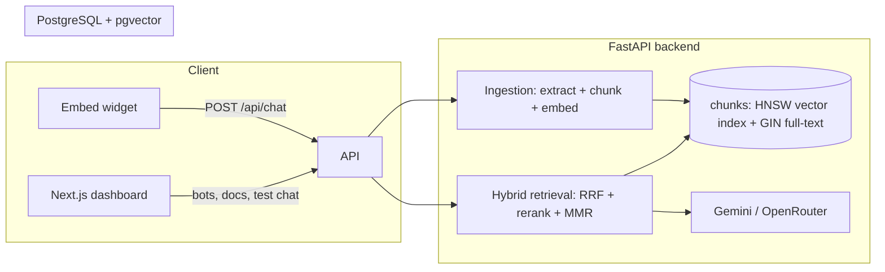

# ai-chatbot-builder

A full-stack, multi-tenant **AI chatbot builder** with an advanced **hybrid RAG** retrieval pipeline. Create chatbots from a dashboard, upload knowledge in 7 file formats, and embed a chat widget on any website with a single `<script>` tag.

> Built as an engineering showcase: real retrieval research (dense + keyword fusion, cross-encoder reranking, MMR diversification, context-window reconstruction) applied in a production-shaped codebase — FastAPI + PostgreSQL/pgvector + Next.js, containerized, with tests and CI.

## Features

| Area | Details |
|---|---|
| **Bot studio** | Create/publish bots, per-bot system prompt, model, colors, domain allowlist |
| **Knowledge upload** | `.txt` `.md` `.pdf` `.docx` `.csv` `.json` `.html` with type-aware text extraction |
| **Structure-aware chunking** | Paragraph + sentence segmentation (Arabic & Western punctuation), tail-overlap carryover, character-window fallback |
| **Hybrid retrieval** | Dense (pgvector cosine) **+** PostgreSQL full-text keyword search, fused with **Reciprocal Rank Fusion** |
| **Cross-encoder rerank** | Optional reranking stage (`ms-marco-MiniLM-L-6-v2`) after fusion |
| **MMR diversity** | Lambda-weighted Maximal Marginal Relevance suppresses near-duplicate chunks |
| **Multi-query expansion** | LLM-generated parallel query variants merged into the fusion (config-gated) |
| **Context reconstruction** | Adjacent-chunk window expansion reassembles truncated context under a character budget |
| **Relevance threshold** | Low-similarity results refused instead of hallucinated from |
| **Embeddable widget** | Shadow-DOM chat bubble, one script tag, XSS-safe text rendering |
| **Dashboard** | Next.js dashboard with test-chat + upload UI and per-browser password auth |
| **Ops** | Docker Compose, HNSW + GIN indexes auto-created at startup, GitHub Actions CI |

## Architecture



**Retrieval pipeline (per question):** multi-query variants → dense candidates (each variant) → keyword candidates → RRF fusion → cross-encoder rerank → MMR selection → neighbor expansion → token-budgeted context → LLM.

Deep dive: [`IMPLEMENTATION_GUIDE.md`](IMPLEMENTATION_GUIDE.md) documents the design decisions (tenant-scoped retrieval, index choices, security model).

## Quick start (local)

Prereqs: Docker, Node.js 18+, a Google Gemini or OpenRouter API key.

```bash
cp .env.example .env          # then set OPENROUTER_API_KEY
docker compose up --build -d  # db + redis + API on :8000
cd frontend && npm install && npm run dev
```

Open **http://localhost:3000** → create a bot → upload a document → publish → test chat in the browser. Embed on any page:

```html
<script src="http://localhost:8000/widget.js" data-bot-id="YOUR_BOT_ID" data-api-base="http://localhost:8000"></script>
```

API reference: http://localhost:8000/docs

## Stack

FastAPI · SQLAlchemy 2 · PostgreSQL 16 + pgvector · sentence-transformers (+ CrossEncoder) · PyMuPDF · Next.js 15 · React 19 · Docker

## Configuration

All tuning lives in the environment (see `.env.example`): chunk size/overlap, top-k, similarity threshold, MMR lambda, reranker and multi-query switches, context budget. Retrieval is safe to reconfigure per deployment without code changes.

## Security model (honest scope)

- Dashboard API is guarded by a shared password (`DASHBOARD_PASSWORD`); tenant scoping is enforced at the query level — **vector similarity searches are always filtered by tenant AND bot IDs**.
- The public `/api/chat` only serves published bots and enforces domain allowlists when configured.
- Deliberately **not included** (documented shortcuts, good interview talking points): OIDC/JWT per-user auth, rate limiting, OCR, background ingestion queue, Alembic migrations, audit logging. See `IMPLEMENTATION_GUIDE.md` for the hardening checklist.

## Roadmap ideas

- Background ingestion worker with per-document processing status
- Semantic chunking + parent-document retrieval (small-to-large)
- Streaming chat responses (SSE)
- Retrieval evaluation harness (recall@k) over golden Q/A datasets

## License

MIT — see [LICENSE](LICENSE).
